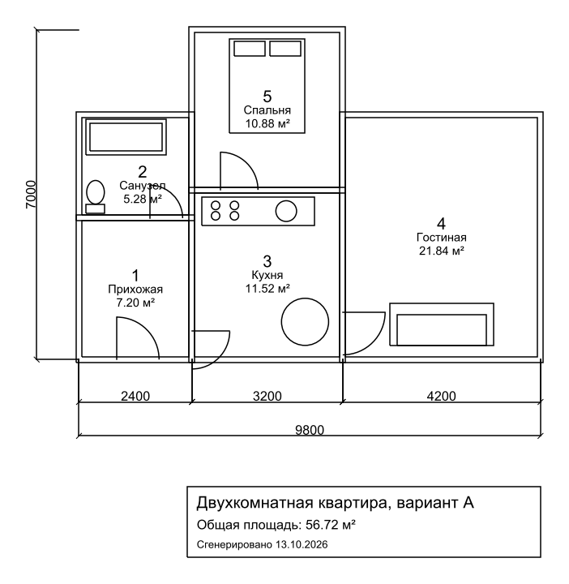

# 01 · CAD-автоматизация: план из JSON + Revit-скрипт

Два инструмента, которые убирают рутину из оформления чертежей интерьеров.

## `dxf_plan_generator.py` — план квартиры из описания

Описываешь помещения в JSON (или получаешь JSON от нейросети по текстовому ТЗ) —
скрипт выпускает готовый DXF для AutoCAD / nanoCAD / BricsCAD:

| Слой | Что рисуется |
|---|---|
| `WALLS` | стены заданной толщины |
| `DOORS` | проёмы с дугой открывания |
| `TEXT` | номер, название и площадь помещения |
| `DIMS` | размерные цепочки и габарит |
| `FURNITURE` | мебель из библиотеки блоков (кровать, диван, кухня, ванна, унитаз, стол) |

Плюс PNG-превью и экспликация помещений в CSV (открывается в Excel без «кракозябр»).

```bash
pip install -r requirements.txt
python dxf_plan_generator.py examples/apartment.json -o output/
```



Ошибки во входных данных (дубли номеров, нулевые размеры, неизвестный блок мебели)
не «проглатываются» — скрипт останавливается и говорит, что не так.

**Идея развития:** связка с LLM — пользователь пишет «двушка 56 м², кухня-гостиная,
санузел совмещённый», модель возвращает JSON по схеме `examples/apartment.json`,
генератор строит чертёж.

## `revit/room_tagger_and_schedule.py` — pyRevit-кнопка

В активном плане этажа:
1. перенумеровывает помещения слева направо, сверху вниз (`101, 102…`);
2. ставит марки туда, где их нет;
3. выгружает экспликацию (номер, имя, площадь, периметр) в CSV.

Нумерация идёт в два прохода через временные номера — так Revit не ругается
на занятые номера при перестановке. Всё в одной транзакции: при ошибке откат.

> ⚠️ Скрипт написан по документации Revit API (2022+), но пока не прогонялся
> в живом Revit — проверять на копии модели.
