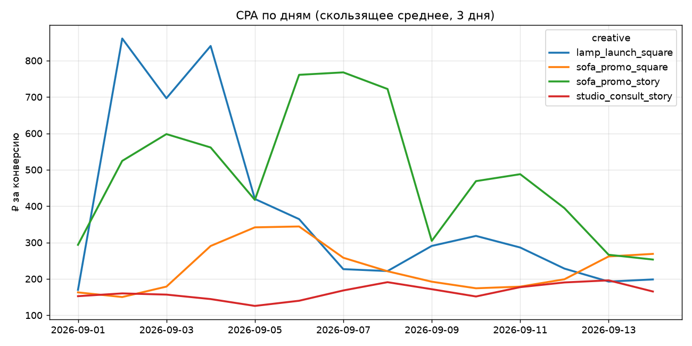

# Отчёт по кампании

Источник: `campaign_stats_DEMO_synthetic.csv`

| creative             |   impressions |   clicks |   conversions |   spend |   CTR_% |   CR_% |     CPA |   p_vs_leader |   budget_share_% |
|:---------------------|--------------:|---------:|--------------:|--------:|--------:|-------:|--------:|--------------:|-----------------:|
| studio_consult_story |        120856 |     2368 |           135 | 21133.8 |   1.959 |  5.701 | 156.547 |       nan     |           86.848 |
| sofa_promo_square    |        125699 |     2292 |           106 | 22648   |   1.823 |  4.625 | 213.66  |         0.097 |            4.384 |
| lamp_launch_square   |        125548 |     1464 |            84 | 21906.6 |   1.166 |  5.738 | 260.793 |         0.962 |            4.384 |
| sofa_promo_story     |        126558 |     3050 |            72 | 22914.5 |   2.41  |  2.361 | 318.257 |         0     |            4.384 |

## Выводы

- Лидер по CPA: **studio_consult_story** — 157 ₽ за конверсию.
- sofa_promo_square: отличие по конверсии пока **не значимо** — нужно больше данных (p = 0.097).
- lamp_launch_square: конверсия на уровне лидера, но CTR заметно ниже — переделывать визуал и заголовок, а не оффер (p = 0.962).
- sofa_promo_story: конверсия из клика **значимо ниже** (p < 0.05) — проблема в оффере или посадочной (p = 0.000).
- sofa_promo_story лучше всех по CTR, но не по CPA: креатив привлекает клики, а не покупателей — проверить соответствие обещания на баннере и посадочной.

## Бюджет на следующий период

- studio_consult_story: 87%
- sofa_promo_square: 4%
- lamp_launch_square: 4%
- sofa_promo_story: 4%

